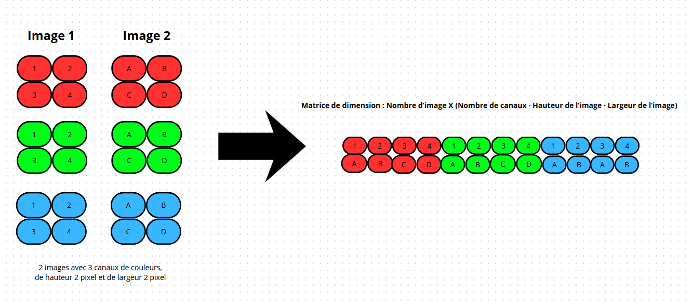
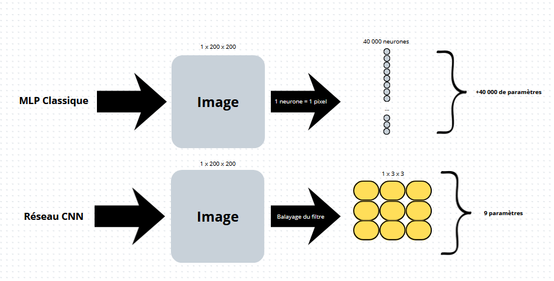
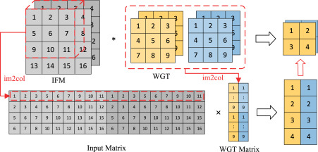
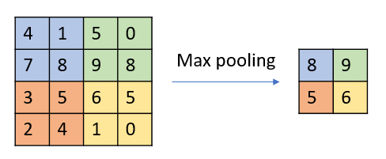
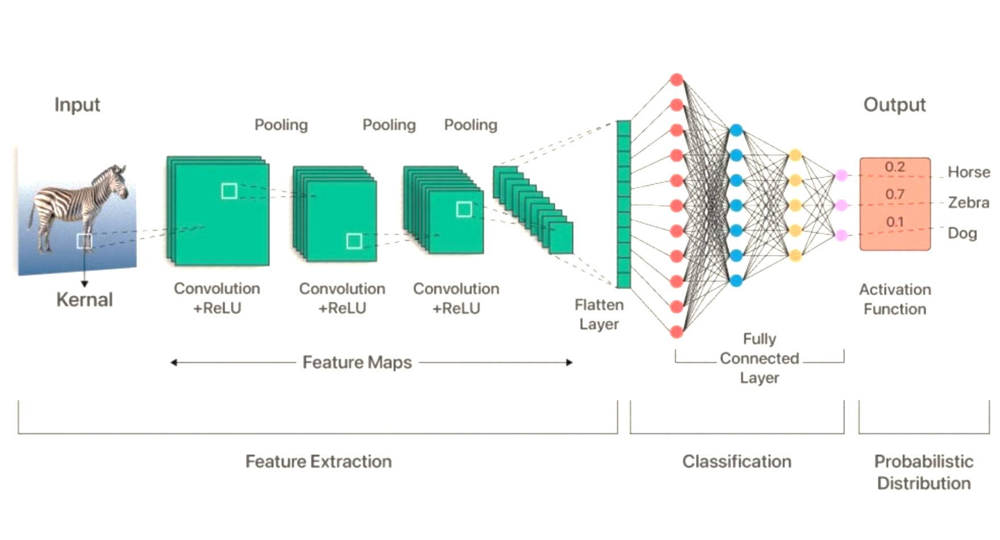
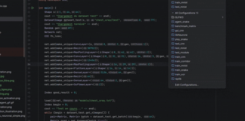

# Réseau de neurones & Agent DQN / CNN from scratch en C++

Un réseau de neurones, un agent qui apprend à jouer à Snake, ainsi qu'un réseau CNN codés en C++17, sans utiliser aucune bibliothèque externe (PyTorch, TensorFlow).

Le projet part du calcul le plus simple et va jusqu'à un agent qui apprend à jouer à Snake et à reconnaitre des images, tout seul, en passant par toutes les étapes intermédiaires. Chaque étape est vérifiée par des tests automatiques : plus de **580 tests** au total.

Projet personnel fait pour comprendre comment fonctionne un réseau de neurones, plutôt que d'utiliser un outil qui fait tout à ma place.

---

## Sommaire

- [Résultats](#résultats)
- [Démonstration](#démonstration)
- [Comment ça marche : les maths derrière](#comment-ça-marche--les-maths-derrière)
  - [Une couche de neurones](#une-couche-de-neurones)
  - [Les fonctions d'activation](#les-fonctions-dactivation)
  - [Fonction de perte](#fonction-de-perte)
  - [Corriger les poids : la descente de gradient](#corriger-les-poids--la-descente-de-gradient)
  - [La rétropropagation](#la-rétropropagation)
  - [Optimiseur Adam](#optimiseur-Adam)
  - [Apprendre à jouer : léquation de Bellman](#apprendre-à-jouer--léquation-de-bellman)
  - [La convolution](#la-convolution)
  - [Les filtres et l'astuce im2col](#les-filtres-et-lastuce-im2col)
  - [Le max pooling](#le-max-pooling)
- [Architecture](#architecture)
- [Réseau convolutifs (CNN)](#réseau-convolutifs-cnn)
  - [Chiffres manuscrits (MNIST)](#chiffres-manuscrits-mnist)
  - [Radiographies pulmonaires (pneumonie)](#radiographies-pulmonaires-pneumonie)
  - [Les données et leur chargement](#les-données-et-leur-chargement)
  - [Entraîner, tester, visualiser](#entraîner-tester-visualiser)
  - [Interface graphique](#interface-graphique)
  - [Limites et pistes du CNN](#limites-et-pistes-du-cnn)
- [Compilation et exécution](#compilation-et-exécution)
- [Choix de conception](#choix-de-conception)
- [Tests](#tests)
- [Limites connues](#limites-connues)
- [Pistes d'amélioration](#pistes-damélioration)
- [Structure du dépôt](#structure-du-dépôt)

---

## Résultats

| Ce qui a été testé | Résultat |
|---|---|
| Calcul des gradients | Vérifié par une méthode numérique, écart inférieur à 1e-7 |
| Apprentissage du XOR, avec la méthode SGD | Erreur finale ≈ 0,0014 après 2000 essais |
| Apprentissage du XOR, avec l'optimiseur Adam | Erreur finale ≈ **8,7e-06** après 5000 essais (environ 4 fois plus rapide) |
| Agent qui apprend dans un couloir de 5 cases | Résolu à chaque fois, en 4 pas |
| Agent qui apprend à jouer à Snake (grille 10×10) | Score moyen sur 200 parties : 18.505 (Pommes mangées) |
| Série de tests | 580 tests, 0 échec |

Exemple de graphique représentant l'évolution de l'agent sur le jeu snake


## Démonstration

Une fois entraîné, l'agent joue tout seul, sans aide :

```
apps/agent_snake.cpp → charge le modèle entraîné et le fait jouer en temps réel dans le terminal
```


L'agent apprend bien à se diriger vers la nourriture. Sa limite principale est qu'il ne voit que les cases juste à côté de sa tête : il ne peut donc pas prévoir qu'il va s'enfermer dans son propre corps une fois qu'il devient trop long.

## Comment ça marche : les maths derrière

Cette section explique l'aspect mathématique des réseaux de neurones.

### Une couche de neurones

Un réseau de neurones est fait de couches. Chaque couche prend des nombres en entrée, les combine, et produit d'autres nombres en sortie.


Concrètement, chaque neurone de sortie fait une somme pondérée de toutes les entrées, puis ajoute une constante appelée **biais**. Si on a $i$ entrées et $j$ sorties :

```math
y_1 = x_1 w_{11} + x_2 w_{21} + \dots + x_i w_{i1} + b_1
```

```math
y_2 = x_1 w_{12} + x_2 w_{22} + \dots + x_i w_{i2} + b_2
```

```math
y_j = x_1 w_{1j} + x_2 w_{2j} + \dots + x_i w_{ij} + b_j
```

On les regroupe donc sous forme matricielle, ce qui donne une seule opération :

```math
Y = XW + b
```

Où :
- $X$ est la matrice d'entrée, de taille $N \times i$ (chaque ligne est un exemple),
- $W$ est la matrice des poids, de taille $i \times j$,
- $b$ est le vecteur de biais, de taille $1 \times j$, ajouté à chaque ligne,
- $Y$ est la sortie, de taille $N \times j$.

C'est d'ailleurs ce que fait la méthode `DenseLayer::forward` dans le code.

### Les fonctions d'activation

Si on empile deux couches l'une derrière l'autre sans rien entre les deux, on obtient :

```math
H = X W_1 + b_1
```

```math
Y = H W_2 + b_2 = (X W_1 + b_1) W_2 + b_2 = X (W_1 W_2) + (b_1 W_2 + b_2)
```

En posant $W' = W_1 W_2$ et $b' = b_1 W_2 + b_2$, on retombe sur $Y = X W' + b'$, c'est-à-dire une seule couche. Empiler des couches ne sert donc à rien tant qu'on ne casse pas cette linéarité. C'est le rôle des fonctions d'activation. On en glisse une entre chaque couche, et elle est appliquée case par case.


Les quatre fonctions implémentées dans ce projet :

**ReLU** : Elle garde les valeurs positives et met tout le reste à zéro.

```math
\mathrm{ReLU}(x) = \max(0, x)
```

Sa dérivée vaut 1 si $x > 0$ et 0 sinon.

**Sigmoïde** : Elle écrase toute valeur entre 0 et 1. A utiliser quand la sortie attendue est une probabilité ou un oui/non.

```math
\sigma(x) = \frac{1}{1 + e^{-x}}
```

```math
\sigma'(x) = \sigma(x) \, (1 - \sigma(x))
```

**Tanh** : même forme que la sigmoïde mais centrée sur zéro (sortie entre -1 et 1).

```math
\tanh(x) = \frac{e^x - e^{-x}}{e^x + e^{-x}}
```

```math
\tanh'(x) = 1 - \tanh^2(x)
```

**Softmax** : Semblable à la fonction sigmoïde où chaque valeur est comprise entre 0 et 1 et la somme de toutes les valeurs est égale à 1. Chaque sortie dépend des autres.

```math
s_i = \frac{e^{z_i}}{\sum_{j=1}^{k} e^{z_j}}
```

```math
\frac{\partial s_i}{\partial z_j} = s_i \, (\delta_{ij} - s_j)
```
où $\delta_{ij}$ vaut 1 si $i = j$, et 0 sinon.

**Identité** : Ne change rien à la valeur. Sa dérivée vaut toujours 1. Elle sert quand la valeur attendue n'est pas bornée, ce qui est le cas de l'agent DQN réalisé dans ce projet.

### Fonction de perte

Pour que le réseau apprenne, il faut qu'il sache à quel point il se trompe. C'est le rôle de la fonction de perte. Dans ce projet, j'utilise l'erreur quadratique : on prend l'écart entre la prédiction et la bonne réponse, on le met au carré, et on fait la moyenne.

```math
L = \frac{1}{2N} \sum_{n=1}^{N} \sum_{k} ( \hat{y}_{nk} - y_{nk} )^2
```

Où $\hat{y}$ est la prédiction du réseau, $y$ la bonne réponse, et $N$ le nombre d'exemples.

Le facteur $\frac{1}{2}$ est là pour simplifier la dérivée. Le carré fait apparaître un facteur 2 en dérivant, et les deux s'annulent. Ainsi le gradient s'écrit :

```math
\frac{\partial L}{\partial \hat{Y}} = \frac{\hat{Y} - Y}{N}
```

Voici les autres fonctions de perte disponible dans le projet :

**BCE Loss (Binary Cross-Entropy)** : Elle s'utilise lorsque le modèle doit choisir entre 2 choix. Elle est souvent utilisée avec la fonction d'activation Sigmoïde.

```math
L = -\frac{1}{N} \sum_{n=1}^{N} \sum_{k} \left[ y_{nk} \ln(p_{nk}) + (1 - y_{nk}) \ln(1 - p_{nk}) \right]
```

```math
\frac{\partial L}{\partial p_{nk}} = \frac{1}{N} \cdot \frac{p_{nk} - y_{nk}}{p_{nk} \, (1 - p_{nk})}
```
 

**CCE Loss (Categorical Cross-Entropy)** : Elle s'utilise quand il y a 3 classes ou plus (Par exemple pour prédire si une image est un chat, un chien ou un oiseau).


```math
L = -\frac{1}{N} \sum_{n=1}^{N} \sum_{k} y_{nk} \ln(p_{nk})
```

```math
\frac{\partial L}{\partial p_{nk}} = -\frac{1}{N} \cdot \frac{y_{nk}}{p_{nk}}
```

### Corriger les poids : la descente de gradient

Maintenant qu'on sait mesurer l'erreur, on cherche maintenant à la diminuer grâce à la descente de gradient.


La pente en un point donné, c'est le **gradient** qui correspond la dérivée de l'erreur par rapport à chaque poids. Il indique dans quelle direction l'erreur *augmente* le plus vite. On va donc dans le sens inverse :

```math
w \leftarrow w - \eta \cdot \frac{\partial L}{\partial w}
```

Où $\eta$ est le **taux d'apprentissage**, c'est-à-dire la taille du pas. Trop grand, on saute par-dessus le minimum et ça diverge. Trop petit, ça prend beaucoup de temps. C'est le réglage le plus important à ajuster dans un réseau de neurones.

Le signe moins fait qu'on descend au lieu de monter.

### La rétropropagation

 On sait calculer l'erreur à la sortie du réseau, mais comment savoir de combien chaque poids de la première couche est responsable de cette erreur, alors qu'il est séparé de la sortie par plusieurs autres couches ?

On applique la règle de dérivation en chaîne. La dérivée d'une composition de fonctions est le produit des dérivées de chaque étape. On part donc de l'erreur à la sortie et on la fait remonter couche par couche, en la multipliant à chaque fois par la dérivée locale de la couche traversée.


Pour une couche dense, il faut calculer **trois** dérivées. En notant $\frac{\partial L}{\partial Y}$ le gradient qui arrive depuis la couche suivante :

**Le gradient des poids** : De combien faut-il corriger chaque poids :

```math
\frac{\partial L}{\partial W} = X^{T} \cdot \frac{\partial L}{\partial Y}
```

**Le gradient du biais** : On additionne les contributions de tous les exemples du groupe :

```math
\frac{\partial L}{\partial b} = \sum_{n=1}^{N} \frac{\partial L}{\partial Y_{n}}
```

**Le gradient de l'entrée** : C'est lui qu'on transmet à la couche précédente, pour que la chaîne continue :

```math
\frac{\partial L}{\partial X} = \frac{\partial L}{\partial Y} \cdot W^{T}
```

Pour une couche d'activation, il suffit de multiplier case par case le gradient reçu par la dérivée de la fonction, évaluée sur l'entrée mémorisée :

```math
\frac{\partial L}{\partial X} = \frac{\partial L}{\partial Y} \odot f'(X)
```

Le symbole $\odot$ désigne la multiplication case par case (produit de Hadamard).

```math
\frac{\partial L}{\partial w} \approx \frac{L(w + \varepsilon) - L(w - \varepsilon)}{2\varepsilon}
```

### Optimiseur Adam

La descente de gradient simple avance toujours du même pas, dans la direction indiquée par le gradient du moment. Ça fonctionne, mais ça oscille beaucoup et ça peut être lent.

L'optimiseur Adam permet d'améliorer ça. D'abord il garde une **moyenne des gradients passés**, ce qui lisse les oscillations. Ensuite il garde une moyenne des carrés des gradients, et s'en sert pour adapter la taille du pas à chaque poids individuellement.

Moyenne des gradients passés (le premier moment) :

```math
m_t = \beta_1 \, m_{t-1} + (1 - \beta_1) \, g_t
```

Moyenne des carrés des gradients (le second moment) :

```math
v_t = \beta_2 \, v_{t-1} + (1 - \beta_2) \, g_t^2
```

Correction du démarrage :

```math
\hat{m}_t = \frac{m_t}{1 - \beta_1^t}
```

```math
\hat{v}_t = \frac{v_t}{1 - \beta_2^t}
```

Mise à jour du poids :

```math
w \leftarrow w - \eta \cdot \frac{\hat{m}_t}{\sqrt{\hat{v}_t} + \epsilon}
```

Avec les valeurs usuelles $\beta_1 = 0.9$, $\beta_2 = 0.999$ et $\epsilon = 10^{-8}$. $g_t$ est le gradient à l'étape $t$, et $t$ compte le nombre de mises à jour effectuées depuis le début.

### Apprendre à jouer : l'équation de Bellman

Tout ce qui précède suppose qu'on connaît la bonne réponse pour chaque exemple. Pour XOR, c'est le cas, on sait que $0 \oplus 1 = 1$.

Mais pour Snake, personne ne dit à l'agent quelle était la bonne direction. Il joue, il meurt au bout de 40 coups, et il faut déterminer lequel de ces 40 coups était mauvais. C'est le problème que résout l'apprentissage par renforcement.

L'idée est de faire apprendre au réseau une fonction $Q(s, a)$ pour une situation $s$ et une action $a$, combien de points je peux espérer gagner au total si je fais cette action maintenant et que je joue bien ensuite. Si on connaissait parfaitement $Q$, jouer serait trivial : dans chaque situation, on prend l'action de plus grande valeur.

L'équation de Bellman donne une façon de calculer une valeur proche :

```math
Q(s, a) = r + \gamma \cdot \max_{a'} Q(s', a')
```

La valeur d'une action, c'est la récompense immédiate $r$, plus la meilleure valeur possible depuis la situation suivante $s'$, réduite par un facteur $\gamma$ (gamma entre 0 et 1). Ce facteur dit à quel point l'agent est patient.

Quand la partie se termine, la valeur est simplement $Q(s,a) = r$.


Cette équation transforme le problème en un apprentissage classique : elle fournit un target, et on retombe sur exactement le même mécanisme que pour XOR (erreur, gradient, correction des poids).

Brique de focntionnement :

**Le réseau cible** : La valeur à viser fait intervenir $Q$ du coup suivant, calculée par le réseau lui-même. On entraîne donc le réseau vers une cible qu'il produit, et qui bouge à chaque correction ce qui fausse les valeurs. La solution est d'utiliser une copie figée du réseau pour calculer les cibles, et de ne la remettre à jour que toutes les quelques milliers d'étapes.

**La mémoire des situations passées** : Deux coups consécutifs se ressemblent énormément, ce qui pose problème pour l'apprentissage (le réseau ne voit que la situation du moment et oublie le reste). On stocke donc des dizaines de milliers de situations vécues, et on pioche dedans au hasard pour s'entraîner.

### La convolution

Les couches denses prennent une ligne de nombre en entrée. Une image est une grille de pixel, on crée alors une matrice telle que son nombre de lignes correspond au nombre d'images (Une image = une ligne de la matrice). Ainsi dans ce projet, un pixel de C canaux de couleurs, de hauteur H et de largeur L, le pixel du canal c, de la hauteur h et de la largeur l sera mis dans la colonne :

```math
c \cdot H \cdot L + h \cdot L + l
```



On normalise le niveau des couleurs variant de 0 à 255 de sorte à ce que ça tienne entre 0 et 1.

Passer une image directement dans les couches denses d'un MLP posent 3 problèmes :

**Le nombre de paramètres :** Pour une simple image de 200x200 pixels en couleurs, cela nécessite 120 000 poids pour chaque neurone de la première couche. Cela conpléxifie les calculs en plus de saturer la mémoire.

**La structure :** Un réseau de neurones classique traite les pixels comme une suite de valeur. Il ne sait pas que 2 pixels côte à côte. Il ignore que deux pixels côte à côte forment une forme, un contour ou une texture. 

**Manque de généralisation :** Dans un réseau de neurones classique, si un élèment se trouve en haut à gauche de l'image puis se déplace en bas à droite, les pixels changent de place. Le réseau le considérera comme un objet totalement différent.

On utilise alors la convolution pour régler ces problèmes. Ce principe consiste à extraire les caractéristiques d'une image en balayant plusieurs filtres de taille $k \times k$ sur celle-ci. À chaque position, on calcule la somme pondérée des pixels qui se trouvent sous le filtre, et on ajoute un biais. On obtient alors carte de caractéristiques. Ainsi, au lieu d'avoir un poid par pixel, on a 1 poid par case de filtre.

Pour le filtre $f$, à la position $(h, l)$ :

```math
Y_{f,h,l} = b_f + \sum_{c=1}^{C} \sum_{i=0}^{k-1} \sum_{j=0}^{k-1} X_{c,\,h+i,\,l+j} \; K_{f,c,i,j}
```

Sans bord ajouté et avec un pas de 1, chaque filtre produit une carte de caractéristique de taille $(H - k + 1) \times (L - k + 1)$. Avec un filtre de 3×3, une image de 28×28 devient une image de 26×26, et une image de 64×64 devient une image de 62×62.



### Les filtres et l'astuce im2col

Écrire six boucles imbriquées afin de calculer la carte de caractéristiques d'une image peut vite devenir lent et ne permet pas d'exploiter la puissance de calcul d'un GPU. Dans ce projet, j'utilise la multiplication matricielle pour réaliser ce calcul. Pour cela, il faut ranger les poids et l'image d'une façon précise.

**La matrice de poids :** Un filtre voit les C canaux de l'entrée, avec $k \times k$ valeurs par canal. On l'aplatit en une ligne de $C \cdot k \cdot k$ valeurs. On place d'abord les k² valeurs du canal 0 les uns après les autres (lignes par lignes), puis ceux du canal 1 etc... Chaque ligne de la matrice représente un filtre. On forme ainsi la matrice de poids W et la matrice de biais b tel que :

```math
W \in \mathbb{R}^{F \times (C \cdot k \cdot k)} \qquad b \in \mathbb{R}^{1 \times F}
```

Par exemple, la deuxième convolution du deuxieme réseau CNN du projet sur les radiographies a C = 8 canaux en entrée, des filtres de dimension k = 3, et F = 16 filtres. Ainsi, sa matrice de poids et des dimensions $16 \times 72$.

**La matrice im2col :** Chaque position du filtre sur l'image correspond à un petit bloc de l'image. On crée une matrice im2col tel que son nombre de lignes correspond aux positions du filtre sur l'image. Pour chaque position, on prend le bloc formé sur les canaux, puis on les allignent lignes par lignes en commençant par le canal 0, puis le canal 1 etc... Pour un lot de N images, $N \times H' \times L'$ lignes, où $H'$ et $L'$ sont la hauteur et la largeur de la sortie. La convolution devient alors le calcul d'une couche dense :

```math
Y_{col} = \mathrm{im2col}(X) \cdot W^{T} + b
```

Chaque ligne de $Y_{col}$ correspond à une position du filtre et chaque colonne à un filtre (Elle a comme dimension $position \times F$). Puis, on remet le resultat dans l'ordre respectant la forme (nbFiltres, hauteur, largeur) attendu par la couche suivante.



Comme le calcul le même qu'un MLP classique, les gradients ont la même forme que pour une couche dense (on a $Y = X' \cdot W' + b $ où $X' = im2col(X)$ et $W' = W^{T}$).

```math
\frac{\partial L}{\partial W} = \left( \frac{\partial L}{\partial Y_{col}} \right)^{T} \cdot \mathrm{im2col}(X)
\qquad
\frac{\partial L}{\partial b} = \sum_{\text{lignes}} \frac{\partial L}{\partial Y_{col}}
```

```math
\frac{\partial L}{\partial\, \mathrm{im2col}(X)} = \frac{\partial L}{\partial Y_{col}} \cdot W
```

Cette dernière matrice est ensuite recollée dans la forme de l'image pour la rendre à la couche précédente dans le backward. Un même pixel appartient à plusieurs blocs qui se chevauchent. Ses contributions sont donc additionnées. On ne garde que la plus grande valeur de chaque carré.

### Le max pooling

Après une convolution, on cherche à réduire la taille de l'image. On la découpe en carré de $p \times p$ pixels sans que ces carrés se chevauchent. 



Avec $p = 2$, la hauteur et la largeur sont divisées par 2 (26×26 devient 13×13) et le nombre de canaux ne change pas. Quand la taille est impaire (29×29 devient 14×14), la dernière ligne et la dernière colonne sont ignorées (C'est négligeable sur le resultat).

Pour la rétropropagation, seule la plus grande valeur de chaque carré a influencé la sortie. Le gradient est donc renvoyé uniquement à sa position, que la couche a mémorisée pendant le calcul avant, et vaut 0 pour les autres pixels du carré.

La couche **Flatten** ne calcule rien vue que les images sont déjà rangées à plat, une par ligne. Elle marque le passage entre la partie qui travaille sur des images et la partie dense, et elle vérifie les dimensions.

**Exemple d'un réseau CNN complet :**



## Architecture


```
Matrix (Un tableau de nombres, stocké de façon optimisé)
   │
   ├── Layer (une couche du réseau)
   │     ├── DenseLayer          — La couche qui fait le calcul : y = x·W + b
   │     └── ActivationLayer     — Ajoute de la non-linéarité au réseau
   │           ├── ReLU
   │           ├── Sigmoide
   │           ├── Tanh
   │           └── Identity
   │
   ├── Network                   — Stocke plusieurs couches, calcule dans les deux sens
   │
   ├── Loss
   │     └── QuadraLoss          — Mesure l'écart entre la prédiction et la bonne réponse à viser
   │
   ├── Optimizer
   │     ├── SGD                 — Méthode simple de mise à jour des poids
   │     └── Adam                — Méthode plus rapide et plus stable
   │
   └── Serializer                — Sauvegarde et recharge les poids d'un réseau entraîné

Environment (Un monde dans lequel un agent peut agir)
   ├── CorridorEnv                — Un couloir simple pour vérifier que l'agent marche
   └── SnakeEnv                   — Le jeu Snake

ReplayBuffer                     — Garde en mémoire les dernières situations vécues par l'agent
EpsilonSchedule                  — Dit à l'agent s'il explore au hasard ou non
DQNAgent                         — Assemble tout pour apprendre à jouer
```
## Réseau convolutifs (CNN)

Après l'agent DQN, j'ai ajouté des classes permettant de constuire un réseau CNN permettant de travailler sur des images. J'ai pu traiter deux problèmes dans ce projet : reconnaître des chiffres écrits à la main (MNIST), puis détecter une pneumonie sur des radiographies du thorax.

La convolution, le max pooling, le chargement de dataset et l'interface graphique sont écrits à la main, sans bibliothèque externe (hormis pour extraire les pixels d'une image et l'interface graphique). Les CNN réutilisent le même `Network`, le même optimiseur Adam, la même perte CCE et le même `Serializer` que le reste du projet. Seules de nouvelles couches ont été ajoutées.

Les nouveaux éléments :

```
Layer (une couche du réseau)
   ├── ConvLayer             : Convolution : fait glisser des filtres sur l'image (via im2col)
   ├── MaxPoolingLayer       : Réduit l'image en gardant la plus grande valeur de chaque carré
   ├── FlattenLayer          : Passe d'une image à une simple liste de nombres
   └── SoftmaxLayer          : Transforme les sorties en probabilités (somme égale à 1)
 
Shape                        : Décrit une image : nombre de canaux, hauteur, largeur
DatasetImage                 : Charge un jeu d'images et leurs étiquettes et les mélange
PredictionCnn                : Prépare ce que l'interface affiche : la prédiction et les probabilités
```

### Chiffres manuscrits (MNIST)

MNIST contient 70 000 images de 28×28 pixels en niveaux de gris, dont 60 000 pour l'entraînement et 10 000 pour le test.

| Mesure | Valeur |
|---|---|
| Précision sur les 10 000 images de test | **97,76 %** (environ 224 images mal reconnues) |
| Entraînement | 10 epochs, lots de 64 images, Adam (taux d'apprentissage 0,001), perte CCE |
| Erreur d'entraînement finale | ≈ 0,057 |
| Temps d'entraînement | ≈ 376 s sur mon PC portable en Release avec RTX 4070 Mobile et intel ultra core 7 155h, soit environ 38 s par epoch |
| Nombre de poids du réseau | 13 610 |

| Étape | Couche | Taille de la sortie | Poids |
|---|---|---|---|
| Entrée | Image 1 × 28 × 28 | 784 | |
| 1 | Convolution : 8 filtres de 3×3 | 8 × 26 × 26 = 5 408 | 80 |
| 2 | ReLU | 5 408 | 0 |
| 3 | Max pooling 2×2 | 8 × 13 × 13 = 1 352 | 0 |
| 4 | Flatten | 1 352 | 0 |
| 5 | Couche dense | 10 | 13 530 |
| 6 | Softmax | 10 probabilités | 0 |

Le réseau donne une probabilité pour chacun des 10 chiffres, et le chiffre deviné est celui qui a la plus grande probabilité. Les poids se sauvegardent et se rechargent avec le même `Serializer` que pour le DQN.

### Radiographies pulmonaires (pneumonie)

Pour tester le CNN sur un vrai problème, je l'ai entraîné sur des radiographies du thorax. Le réseau doit dire si une image est "NORMAL" ou "PNEUMONIA". Les images viennent du jeu *Chest X-Ray Images (Pneumonia)* de Kermany et al. (Cell, 2018), disponible sur [Kaggle](https://www.kaggle.com/datasets/paultimothymooney/chest-xray-pneumonia) sous licence CC BY 4.0. Il contient environ 5 200 images d'entraînement et 624 images de test. Elles sont converties en niveaux de gris et réduites à 64 × 64 pixels.

| Mesure | Valeur |
|---|---|
| Précision sur les 624 images de test | **76,60 %** (478 images bien classées) |
| Entraînement | 20 epochs depuis zéro, puis 67 epochs de plus en reprenant le modèle sauvegardé. Lots de 32 images, Adam (taux d'apprentissage 0,001), perte CCE |
| Précision après les 20 premières epochs | 76,28 % |
| Erreur d'entraînement finale | ≈ 0,000002 |
| Temps d'entraînement | environ 30 s par epoch sur mon PC portable en Release avec RTX 4070 Mobile et intel ultra core 7 155h (≈ 10 min pour 20 epochs, ≈ 33 min pour 67) |
| Nombre de poids du réseau | 202 146 |


| Étape | Couche | Taille de la sortie | Poids |
|---|---|---|---|
| Entrée | Image 1 × 64 × 64 | 4 096 | |
| 1 | Convolution : 8 filtres de 3×3 | 8 × 62 × 62 = 30 752 | 80 |
| 2 | ReLU | 30 752 | 0 |
| 3 | Max pooling 2×2 | 8 × 31 × 31 = 7 688 | 0 |
| 4 | Convolution : 16 filtres de 3×3 | 16 × 29 × 29 = 13 456 | 1 168 |
| 5 | ReLU | 13 456 | 0 |
| 6 | Max pooling 2×2 | 16 × 14 × 14 = 3 136 | 0 |
| 7 | Flatten | 3 136 | 0 |
| 8 | Couche dense | 64 | 200 768 |
| 9 | ReLU | 64 | 0 |
| 10 | Couche dense | 2 | 130 |
| 11 | Softmax | 2 probabilités | 0 |

Presque tous les poids (200 768 sur 202 146) sont dans la première couche dense, entre les 3 136 valeurs aplaties et les 64 neurones.

**Attention, ce n'est pas un outil médical. Ce projet sert à apprendre à écrire un CNN. Un score de 76,6 % n'a aucune valeur de diagnostic.**

### Les données et leur chargement

La classe `DatasetImage` charge un jeu d'images selon un type donné à sa création :

| Type | Format | État |
|---|---|---|
| 0 | Un dossier par classe, contenant des images PNG, JPG ou BMP (le nom du dossier est le nom de la classe). Les images sont converties au nombre de canaux voulu et redimensionnées à la taille voulue | Fonctionne (radiographies) |
| 1 | Fichiers IDX, le format de MNIST | Fonctionne (MNIST) |
| 2 et 3 | Étiquettes lues dans un fichier de noms ou dans un CSV | Prévus, pas encore écrits |

Les images sont rangées dans une matrice (une image par ligne : 784 colonnes pour MNIST, 4 096 pour les radiographies en 64×64). Les étiquettes sont dans une matrice à une seule valeur à 1 par ligne : pour un « 7 », la ligne contient dix valeurs, avec un 1 en position 7 et des 0 ailleurs. Pour le type 0, les classes sont rangées par ordre alphabétique des noms de dossiers (NORMAL est la classe 0, PNEUMONIA la classe 1). `shuffle()` mélange images et étiquettes de la même façon, et `get_batch(début, taille)` renvoie un lot d'images avec ses étiquettes.

Les jeux de données ne sont pas fournis dans le dépôt (ils sont volumineux). Il faut les télécharger et les placer dans le dossier `dataset_images` :


```
data/dataset_images/
├── MNIST/
│   ├── train/    train-images.idx3-ubyte    train-labels.idx1-ubyte
│   └── test/     t10k-images.idx3-ubyte     t10k-labels.idx1-ubyte
└── chest_xray/
    ├── train/    NORMAL/    PNEUMONIA/
    └── test/     NORMAL/    PNEUMONIA/
```
Pour MNIST, le chargeur repère les fichiers dont le nom contient `idx3` (images) et `idx1` (étiquettes). Les noms écrits avec des tirets, comme `train-images-idx3-ubyte`, fonctionnent donc aussi. Pour les dossiers d'images, le décodage des fichiers PNG, JPG et BMP est fait par `stb_image`, un fichier d'en-tête inclus dans `include/utils/`. Si le jeu des radiographies a été téléchargé depuis macOS, il faut supprimer les dossiers `__MACOSX` et les fichiers `.DS_Store`, qui ne sont pas des images.

### Entraîner, tester, visualiser

```bash
./build/train_mnist    # entraîne le CNN sur MNIST et sauvegarde models/reseau_mnist.txt
./build/test_mnist     # mesure la précision sur les 10 000 images de test de MNIST
./build/train_cnn      # entraîne le CNN sur les radiographies et sauvegarde models/chest_xray.txt
./build/test_cnn       # mesure la précision sur les 624 radiographies de test
./build/gui_cnn        # interface graphique sur les radiographies (nécessite le modèle entraîné)
```

- Le répertoire de travail doit être la racine du dépôt. Sous CLion, il faut régler le « Working directory » de la configuration de lancement, qui est par défaut le dossier de compilation. Sinon les chemins comme `models/chest_xray.txt` ne sont pas trouvés.
- Compiler en **Release** : l'entraînement est plusieurs fois plus lent en Debug.
- Le nombre d'epochs se règle dans le fichier du programme d'entraînement.
- `train_cnn` recharge d'abord `models/chest_xray.txt` s'il existe, puis continue l'entraînement. Pour repartir de zéro, il faut supprimer ce fichier avant de lancer.
- Chaque programme doit reconstruire exactement le même réseau que celui de l'entraînement avant de charger les poids, car le fichier de sauvegarde ne contient que les valeurs.

### Interface graphique

`gui_cnn` ouvre une fenêtre qui montre ce que voit le réseau et ce qu'il répond, image par image, sur les radiographies de test (mélangées au lancement) :

- La radiographie de 64×64 pixels, agrandie et dessinée pixel par pixel ;
- La classe devinée et la probabilité correspondante ;
- Une barre par classe (NORMAL et PNEUMONIA) : la barre de la classe devinée est verte si la réponse est bonne et rouge si elle est fausse, l'autre est grise ;
- La vraie classe et si la réponse est correcte ;
- Les flèches gauche et droite pour passer à l'image précédente ou suivante.




### Limites et pistes du CNN

**Le modèle des radiographies a appris ses images par cœur (surapprentissage).** L'erreur d'entraînement tombe à presque 0 alors que la précision sur le test reste autour de 76 %. Passer de 20 à 87 epochs n'a presque rien changé au test (76,28 % puis 76,60 %). Les images de test viennent aussi d'une autre distribution que celles d'entraînement, ce qui rend ce jeu difficile.

**Pas de jeu de validation.** Je n'ai pas mis de côté des images pour choisir le nombre d'epochs ou arrêter l'entraînement au bon moment.

**Convolution et pooling simples.** La convolution a toujours un pas de 1 et n'ajoute pas de padding.

**C'est lent.** La convolution est écrite avec des boucles simples, sur un seul fil d'exécution. Une epoch prend environ 38 s sur MNIST et 30 s sur les radiographies en Release sur mon PC portable.

**L'architecture est écrite à la main dans chaque programme.** `train_mnist`, `test_mnist`, `train_cnn`, `test_cnn` et `PredictionCnn` construisent chacun leur réseau, et le fichier de sauvegarde ne retient pas sa forme.

**L'interface graphique est branchée sur le modèle des radiographies.** Le réseau construit dans `PredictionCnn.cpp` est celui des radiographies. Pour afficher MNIST, il faut y remettre le réseau de MNIST. Les types 2 et 3 de `DatasetImage` ne sont pas écrits.

Pistes :

- Créer un jeu de validation et arrêter l'entraînement quand son erreur remonte ;
- Ajouter de l'augmentation de données (petits décalages, variations de luminosité) ;
- Ajouter le pas et le bord (padding) à la convolution ;
- Sauvegarder la forme du réseau dans le fichier du modèle, pour ne plus la réécrire dans chaque programme ;
- Choisir le réseau de l'interface graphique selon le jeu de données ;

## Compilation et exécution

Prérequis : CMake ≥ 3.22, un compilateur C++17 (GCC, Clang ou MSVC).

| Élément | À quoi il sert | Obligatoire ? |
|---|---|---|
| Git et une connexion internet pendant la première configuration de CMake | CMake télécharge et compile automatiquement raylib 6.2 (`FetchContent`). Cette première compilation prend quelques minutes | Oui, dès la configuration, même si l'on ne lance pas l'interface |
| Un pilote graphique OpenGL 3.3 et un environnement de bureau | Ouvrir la fenêtre de `gui_cnn` | Pour `gui_cnn` seulement |
| Sous Linux : les paquets de développement X11 et OpenGL | Compiler raylib. Sous Debian ou Ubuntu : `sudo apt install libx11-dev libxrandr-dev libxinerama-dev libxcursor-dev libxi-dev libgl1-mesa-dev libglu1-mesa-dev` | Linux seulement |
| Les 4 fichiers du jeu MNIST (format IDX) | Entraîner et tester le CNN sur les chiffres. Ils sont à placer dans `data/dataset_images/MNIST/` | Pour `train_mnist` et `test_mnist` |
| Le jeu de radiographies *Chest X-Ray Images (Pneumonia)* | Entraîner, tester et visualiser le CNN sur les radiographies. Il est à placer dans `data/dataset_images/chest_xray/` | Pour `train_cnn`, `test_cnn` et `gui_cnn` |
| CUDA Toolkit | Faire les grosses multiplications de matrices sur un GPU NVIDIA | Non. CMake le détecte seul, et sans lui le calcul se fait sur le processeur. L'architecture GPU est fixée à 89 (cartes RTX série 40) dans `CMakeLists.txt`, à changer pour une autre carte |

Le réseau, les couches et l'entraînement restent écrits avec la seule bibliothèque standard du C++. `stb` ne sert qu'à lire les images et raylib qu'à l'interface graphique.

```bash
git clone https://github.com/Riyaneb/Reseau_de_neurones_from_scratch_Cpp.git
cd Reseau_de_neurones_from_scratch_Cpp
mkdir build && cd build
cmake -DCMAKE_BUILD_TYPE=Release ..
cmake --build .
```

Programmes produits :

| Programme | Ce qu'il fait |
|---|---|
| `test_module` | Lance tous les tests |
| `train_xor` | Entraîne un petit réseau sur XOR (avec les deux méthodes d'entraînement) |
| `train_corridor` | Entraîne l'agent sur l'environnement couloir |
| `train_snake` | Entraîne l'agent sur Snake, garde une trace de l'entraînement, sauvegarde le meilleur résultat |
| `play_snake` | Jouer à Snake soi-même, au clavier |
| `agent_snake` | Regarder l'agent entraîné jouer tout seul |
| `benchmark_matrix` | Mesure la vitesse du calcul matriciel selon la façon dont il est écrit |
| `train_mnist` | Entraîne le CNN sur MNIST et sauvegarde le modèle |
| `test_mnist` | Mesure la précision du CNN entraîné sur les images de test de MNIST |
| `train_cnn` | Entraîne le CNN sur les radiographies (reprend le modèle sauvegardé s'il existe) et sauvegarde le modèle |
| `test_cnn` | Mesure la précision du CNN entraîné sur les radiographies de test |
| `gui_cnn` | Interface graphique : parcourir les radiographies de test et voir la réponse du CNN |


Lancer les tests :

```bash
./build/test_module
```

Lancer un entraînement :

```bash
./build/train_snake
./build/agent_snake
```

> Le répertoire de travail doit être la racine du dépôt.

## Choix de conception

Quelques décisions importantes, et pourquoi je les ai prises :

**Les matrices sont stockées comme une seule liste de nombres, pas une liste de listes.**
Plus rapide à parcourir en mémoire.

**Un seul exemple est traité comme un groupe d'un seul élément.**
Le même code sert à traiter un exemple ou 64 en même temps. Pas besoin d'écrire deux versions différentes selon qu'on entraîne le réseau ou qu'on l'utilise.

**Le calcul des gradients a été vérifié à la main**
Pour chaque poids, j'ai comparé le gradient calculé par mon code à une estimation obtenue autrement (en bougeant légèrement le poids et en regardant comment l'erreur change). Les deux résultats concordent presque parfaitement, ce qui prouve que le calcul est juste.

**Le réseau ne sait pas comment il est entraîné.**
Il ne connaît ni la façon de mesurer l'erreur, ni la façon de corriger ses poids. Ça permet de changer de méthode d'entraînement (passer de la méthode simple à Adam par exemple) sans toucher au reste du code.

**Quand l'agent apprend, on ne corrige que l'action qu'il a réellement choisie.**
Pour chaque situation vécue, seule la valeur associée à l'action jouée est corrigée et les trois autres actions possibles restent inchangées. 

**La sauvegarde ne garde que les poids, pas la structure du réseau.**
Pour recharger un modèle, il faut reconstruire un réseau avec exactement la même forme dans le code. Cela permet de simplifier la sauvegarde.

## Tests

La suite de tests (`test_module`) vérifie, dans l'ordre où le projet a été construit :

- toutes les opérations sur les matrices (addition, multiplication, transposée, etc...) 
- le générateur de nombres aléatoires et les méthodes d'initialisation des poids 
- les couches du réseau et les fonctions d'activation 
- que le calcul des gradients est correct
- que la copie d'un réseau est bien indépendante de l'original 
- l'optimiseur Adam 
- les deux environnements de jeu (couloir et Snake) : collisions, demi-tour interdit, limite de temps, etc... 
- la mémoire des situations passées de l'agent (replay buffer)

## Limites connues

**L'agent ne voit que 11 informations simples**, pas la grille entière : y a-t-il un danger devant / à gauche / à droite, dans quelle direction il va, et de quel côté se trouve la nourriture. Ce choix rend l'apprentissage plus rapide, mais l'agent ne voit jamais son propre corps au-delà des cases juste à côté de sa tête. Il apprend donc à aller vers la nourriture, mais peut se retrouver enfermé dans son propre corps une fois qu'il est devenu long, sans pouvoir le prévoir à l'avance.

**La sauvegarde ne garde que les poids, pas la forme du réseau.** Recharger un modèle veut dire reconstruire un réseau de la même forme dans le code avant de charger les valeurs dedans.

**Reprendre un entraînement ne se fait pas exactement où il s'était arrêté.** Certains réglages internes de l'optimiseur (Adam) repartent de zéro.

## Pistes d'amélioration

- **Double DQN** : une variante qui limite le risque que l'agent surestime la valeur de certaines actions.
- **Voir plus loin** : donner à l'agent une vision plus large que les cases juste à côté de lui, pour qu'il puisse anticiper les impasses.
- **Mémoire plus intelligente** : donner plus d'importance aux situations où l'agent s'est le plus trompé, plutôt que de piocher au hasard dans sa mémoire.
- **Récompense progressive** : donner une petite récompense à l'agent quand il se rapproche de la nourriture, pas seulement quand il la mange, pour qu'il apprenne plus vite au début.

## Structure du dépôt

```
include/           déclarations du code, rangées par thème (math, nn, rl, env, io, utils), cnn (convolution, pooling) et gpu (calcul CUDA) s'ajoutent à cette liste
src/               le code lui-même qui correspond à include/
tests/             tous les tests
apps/              les programmes qu'on peut lancer (entraînement, jeu, démonstration)
models/            les réseaux entraînés, sauvegardés
docs/              les images utilisées dans ce README
data/              les données récoltées pendant l'entraînement et les jeux d'images (dataset_images) ainsi que la police de l'interface graphique
```


*Riyane Bouakaz [GitHub](https://github.com/Riyaneb) · [Kaggle](https://kaggle.com/riyanebouakaz) · [LinkedIn](https://linkedin.com/in/riyane-bouakaz)*